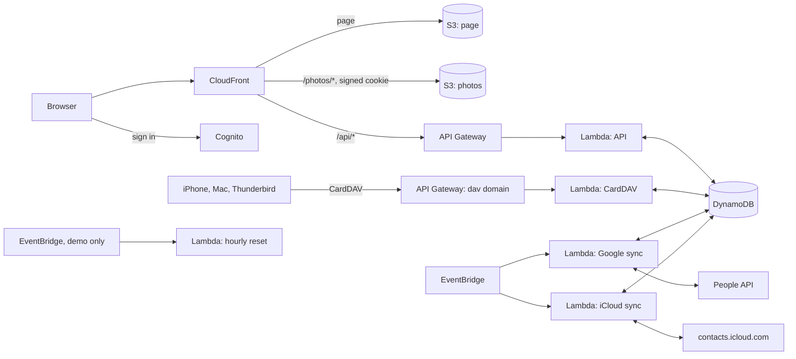

# Contacts

An address book of your own, running serverless on AWS: every field of Apple Contacts and Google Contacts, the full history of each card, search across every field, groups, family relations, duplicates, and sync both ways with iPhone, Mac, Android, Thunderbird and Outlook over CardDAV, with Google Contacts and with iCloud. The address book is the source of truth: it keeps every field, and a card changed on both sides keeps its version here.

Everything is Terraform and AWS managed services: no servers, nothing running between requests and syncs, so an installation costs cents a month (see [Cost](#cost)).

## Demo

The address of the demo is the output `site_url` of its deployment (a `*.cloudfront.net` address); the deploy job prints it.

Sign in with `demo@example.com` / `Demo-Password-1` (the fields are filled in for you).

The demo address book is English and made up. Everything on the page works: create, edit, delete and restore cards, read and restore their history, search (also in the history), merge the duplicates it holds, groups, family relations and the family graph, drafts, import and export of vCard, photos. **The sync is only shown**: Google, iCloud and the devices appear connected, with a sync log of examples, but there is no CardDAV server, and no Google or Apple account behind them. The demo user is an administrator, so the users are there to look at; changing them is not. The demo is public and goes back to its initial state **every hour**: the address books, photos, drafts and logs are wiped, the examples of [`seed/seed.json`](seed/seed.json) are written again, the demo password is put back and any other user is deleted. Changing the password and two-factor authentication are hidden in the demo, so no visitor can lock the others out.

## Features

- **Cards** with every field of Apple and Google: name with pronunciation, maiden name, nickname, "file as", pronouns, work, phones, emails, addresses, websites, birthday (the year may be left out), dates, related people, messengers, social profiles, custom fields, favourites, notes and a photo (from a file or pasted from the clipboard, shrunk to 1024 points by the browser, opened full size on a click).
- **History**: every create, save, delete, restore, import and sync keeps the whole card; the differences between versions, a restore of any version, deleted cards to restore or purge.
- **Search** across every field as you type, phone numbers by their digits, in the other keyboard layout too (`Jkmuf` finds "Ольга"); a switch searches the history and the deleted cards.
- **Drafts** kept on the server: an unsaved edit comes back after a reload or on another device.
- **Duplicates** by a shared phone, a shared email or the same name; a merge keeps one card, fills it from the others and moves them to Deleted, so it can be undone.
- **Groups** as Apple keeps them, with a page per group, and the smart group "No group"; **family relations** in your own words that link cards, and a family graph.
- **A birthday kept out of the calendars**: it goes to Google and the devices as a plain date labelled "Birthday (not in calendar)", so their birthday calendars leave the card out.
- **vCard** 2.1, 3.0 and 4.0, in and out, with Apple's labels and the photos.
- **Sync**: CardDAV for Apple Contacts, Thunderbird, Android (DAVx⁵) and Outlook (CalDav Synchronizer), with an app password per device and a profile for iPhone, iPad and Mac; Google Contacts through the People API; iCloud Contacts through its CardDAV server with an app-specific password. A sync log tells what changed where.
- **Account**: two-factor authentication (TOTP), password change; English, Russian, French and Italian; administrators invite and manage the users.

## How it works



| Part | Service |
| --- | --- |
| Page | S3 + CloudFront, on its own domain or on the `*.cloudfront.net` address |
| Sign-in | Cognito user pool, no self sign-up, optional TOTP; group `admins` |
| API | API Gateway HTTP API with a Cognito JWT authorizer, Lambda `lambda/contacts.py` (Python, arm64) |
| Data | DynamoDB on demand, one table, a partition per user: cards, versions, deleted cards, drafts, groups, app passwords, sync state and log |
| Photos | a private S3 bucket under `photos/<user>/`, served by CloudFront with signed cookies for that prefix only |
| CardDAV | `lambda/carddav.py` on an HTTP API of its own (`dav_domain_name`): CloudFront does not pass `PROPFIND` and `REPORT` |
| Google | `lambda/google_sync.py`, EventBridge every `google_sync_minutes` |
| iCloud | `lambda/icloud_sync.py`, a CardDAV client of iCloud, EventBridge every `icloud_sync_minutes` |
| Demo reset | `lambda/reset.py`, EventBridge `rate(1 hour)` |

### Sync

Each side of a sync is compared with its own fingerprint at the last sync, so a field that Google or iCloud writes a little differently does not go back and forth. A card changed on both sides keeps its version here, which goes out again; the other version is in the sync log as a conflict. A field the other side has no place for, or that a device dropped, stays here. A contact deleted on the other side goes to Deleted here and can be restored. The first sync matches the contacts that are on both sides by UID, then by name and a shared phone or email (a card without a name, by a shared email or phone).

Google needs a web application OAuth client of a Google Cloud project with the People API: its id is `google_client_id`, its secret goes into the SSM SecureString `/<name>/google-client-secret` by hand, and the consent page comes back to `/api/oauth/google`. iCloud needs nothing in AWS: each user enters the Apple ID and an app-specific password (account.apple.com → Sign-In and Security → App-Specific Passwords), kept in SSM per user.

## Test environment and production

The defaults deploy the **test environment**, the public demo above. It is the same code with the sync shown and not run:

- no domain: the page answers at its `*.cloudfront.net` address with CloudFront's certificate, and no DNS is touched;
- no CardDAV server, no Google and no iCloud functions: the page shows them connected (`DEMO`), with the sync log of the seed;
- the sign-in is published and filled in (`demo = true`), password change and two-factor authentication are hidden, and the administration is read-only;
- the hourly reset (`reset_schedule`) rebuilds everything from `seed/seed.json`;
- point-in-time recovery is off, and the buckets are deleted with their content on `terraform destroy`.

**Production** runs the sync. Start from [`examples/production.tfvars`](examples/production.tfvars):

| Variable | Test environment (default) | Production |
| --- | --- | --- |
| `name` | `contacts-serverless` | `contacts` — the prefix of every resource |
| `demo` | `true` | `false` |
| `domain_name`, `route53_zone_name` | `""` — the CloudFront address | `contacts.example.com`, `example.com` |
| `dav_domain_name` | `""` — no CardDAV server | `dav.contacts.example.com` |
| `google_client_id` | `""` — Google only shown | the client id, its secret in SSM |
| `icloud_enabled` | `false` — iCloud only shown | `true` |
| `admin_email` | `demo@example.com` | your address |
| `admin_password` | `Demo-Password-1` | `""` — Cognito mails a temporary password |
| `reset_schedule` | `rate(1 hour)` | `""` — no reset, no examples |

Pick a fresh `name` (and state key): production is a separate deployment, not a change of the demo. The domains need a public Route 53 zone in the same account, where the stack validates the certificates and writes the alias records.

## Deploy

### What you need

1. An S3 bucket for Terraform state (the S3 backend with the native lockfile, Terraform 1.10+).
2. The GitHub OIDC provider in the AWS account and a role for this repository that trusts only jobs of the GitHub environment `demo`. Its permissions: everything named with the `name` prefix (`s3:*` on `arn:aws:s3:::contacts-serverless-*`, the table, functions, roles with `iam:PassRole`, log groups, SSM parameters, EventBridge rules), API Gateway, Cognito and CloudFront (their ids are generated), log delivery for API access logs, and the state objects under the state key prefix. The demo needs no ACM or Route 53; production adds them.
3. In the GitHub repository: the environment `demo`, and the variables `AWS_ROLE_ARN` (the role) and `TF_STATE_BUCKET` (the state bucket). There are no secrets.

### GitHub Actions

[`.github/workflows/terraform.yml`](.github/workflows/terraform.yml) only calls the shared workflow of [Tozapid/demo-ci-cd-skeleton](https://github.com/Tozapid/demo-ci-cd-skeleton):

- every push and pull request: `terraform fmt` and `terraform validate`; the Lambda tests; the page's syntax check;
- pull requests from this repository: `terraform plan` in the environment `demo`;
- a push to `main` or a manual run: plan and apply in the environment `demo`. The job stops if the plan would destroy or replace a bucket, the table or the user pool;
- after `main` is deployed: the GitHub release of the newest `CHANGELOG.md` entry, once.

The jobs get AWS credentials from GitHub's OIDC token: no AWS key is stored anywhere.

### Versions and releases

Every entry of [`CHANGELOG.md`](CHANGELOG.md) starts with its version (`## v0.1.0`, optionally ` — ` and a date or a title), with the changes under `### Added`, `### Changed`, `### Fixed` and `### Security`, newest first. The site takes its version from the newest entry when Terraform deploys it, and the release job makes it a tag and a GitHub release. Settings → Version reads the releases of `releases_repository` and shows those after the version of the site.

### From a workstation

```bash
terraform init \
  -backend-config="bucket=<state bucket>" \
  -backend-config="key=contacts-serverless-aws/terraform.tfstate" \
  -backend-config="region=eu-central-1"
terraform apply                                   # the test environment
terraform apply -var-file=terraform.tfvars        # production, see above
```

## Access and security

- `/api/*` takes only a Cognito token (JWT authorizer); the Lambda also wants a verified email in it, and users cannot change their email. Each user sees and changes only their own address book.
- Photos are private; the API sets a CloudFront signed cookie for one hour that opens only the photos of that user, and photos are served with `Content-Security-Policy: sandbox`.
- CardDAV clients sign in with an app password of their own, kept as a salted hash; Google refresh tokens and iCloud app-specific passwords are SSM SecureStrings, never in the table.
- The page builds its DOM itself and its content security policy allows scripts only from itself and two pinned jsDelivr packages with subresource integrity.

## Tests

```bash
cd lambda && python3 -m unittest discover -v -p '*_test.py'
```

The tests use no network: DynamoDB, S3, Cognito, SSM and the People API are faked, and iCloud is the CardDAV server of this very app with a second user, so the client of iCloud talks to a real server. The reset is tested end to end through the API.

## Cost

| Service | Test environment (demo) | Production, light use* |
| --- | --- | --- |
| Lambda, EventBridge, API Gateway, Cognito, CloudFront | free allowances | free allowances |
| DynamoDB on demand, S3, CloudWatch Logs | a few cents | a few cents |
| **Total** | **cents a month** | **under $1 a month** |

\* A handful of users and devices, syncs every 5 minutes. A WAF web ACL is left out on purpose: it alone would cost about $5–6 a month. Prices change; check the AWS pricing pages for your region.

## Repository

| Path | What it is |
| --- | --- |
| `lambda.tf`, `iam.tf`, `lambda/contacts.py`, `lambda/vcard.py` | The API, its permissions, the cards and vCard |
| `carddav.tf`, `lambda/carddav.py` | The CardDAV server (production only) |
| `google.tf`, `lambda/google_sync.py` | The sync with Google Contacts (with `google_client_id`) |
| `icloud.tf`, `lambda/icloud_sync.py` | The sync with iCloud Contacts (with `icloud_enabled`) |
| `apigateway.tf`, `cognito.tf` | The API and the users |
| `dynamodb.tf`, `s3.tf` | The table, the page and photo buckets |
| `cloudfront.tf`, `cloudfront/`, `dns.tf`, `frontend.tf`, `web/` | The distribution, the domains, the page, its fields (`fields.js`) and translations (`i18n.js`) |
| `reset.tf`, `lambda/reset.py`, `seed/seed.json` | The hourly reset of the demo and its examples |
| `examples/production.tfvars` | A starting point for production |

## Limitations

- Apple has no API for contacts but the CardDAV server of iCloud, which is not documented for third parties; it takes an app-specific password that also opens the mail and the calendars of the Apple ID.
- Google's People API asks for a consent screen; until Google verifies the app, users see a warning and there may be at most 100 of them.
- The new Outlook and Outlook for Mac speak no CardDAV: they import and export vCard only.

## License

[MIT](LICENSE)
